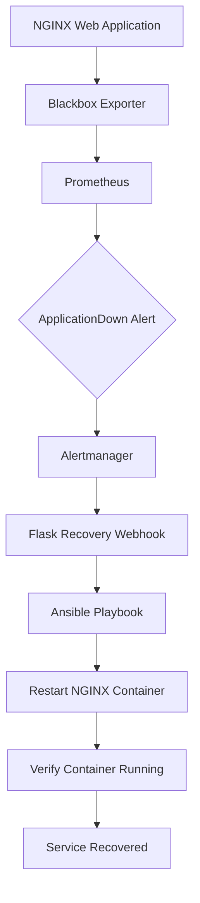

# Self-Healing Infrastructure
### Automated Application Failure Detection & Recovery

A practical DevOps project that monitors an NGINX web application, detects service failure, raises an alert, and automatically recovers the application using Ansible.

> **Project outcome:** A simulated NGINX outage was detected by Prometheus, forwarded through Alertmanager to a Flask webhook, and recovered by an Ansible playbook. Recovery verification completed with `failed=0`.

---

## Project Overview

In traditional environments, an application failure may require an administrator to notice the issue and restart the service manually.

This project demonstrates a monitoring-to-recovery workflow that reduces manual intervention:

**Detect → Alert → Automate → Recover → Verify**

The application is hosted in Docker containers inside a local Ubuntu environment running through WSL.

## Architecture



## Technology Stack

| Technology | Role in this project |
|---|---|
| Ubuntu / WSL | Local Linux environment |
| Docker | Runs the application and monitoring components |
| NGINX | Sample web application |
| Blackbox Exporter | Checks HTTP availability |
| Prometheus | Collects probe metrics and evaluates alert rules |
| Alertmanager | Routes the `ApplicationDown` alert |
| Python / Flask | Receives the alert through a webhook |
| Ansible | Automates container restart and verification |
| Git / GitHub | Version control and project hosting |

## How the Self-Healing Workflow Works

1. NGINX serves the sample web application.
2. Blackbox Exporter sends an HTTP probe to the application.
3. Prometheus collects the `probe_success` metric.
4. When the probe fails, the `ApplicationDown` alert is triggered.
5. Alertmanager sends the alert to the recovery webhook.
6. The Flask webhook invokes the Ansible recovery playbook.
7. Ansible restarts the NGINX container.
8. Ansible verifies that the container is running.

The alert rule uses a 15-second pending period before firing.

## Monitoring & Recovery Components

### Prometheus
- Scrapes the Blackbox Exporter.
- Loads the `ApplicationDown` alert rule.
- Detects application unavailability through `probe_success`.

### Alertmanager
- Receives alerts from Prometheus.
- Routes the alert to the recovery webhook.

### Recovery Webhook
- Built with Python and Flask.
- Receives the Alertmanager HTTP request.
- Executes the Ansible recovery playbook.

### Ansible
- Restarts the NGINX Docker container.
- Checks the container's running state.
- Reports task results through the play recap.

## Container Ports

| Component | Local port |
|---|---:|
| NGINX application | 8081 |
| Prometheus | 9090 |
| Alertmanager | 9093 |
| Blackbox Exporter | 9115 |
| Recovery Webhook | 5000 |

## Project Structure

```text
self-healing-infrastructure/
├── alertmanager/
│   └── alertmanager.yml
├── ansible/
│   └── recovery.yml
├── app/
│   ├── Dockerfile
│   └── index.html
├── blackbox/
│   └── blackbox.yml
├── prometheus/
│   ├── alerts.yml
│   └── prometheus.yml
├── recovery/
│   ├── Dockerfile
│   └── webhook.py
├── screenshots/
│   ├── 1-NGINX application running.PNG
│   ├── 2-Prometheus target UP.PNG
│   ├── 3-Failure detection probe_success = 0.PNG
│   ├── 4-Prometheus ApplicationDown rule loaded.PNG
│   └── 5-Automatic recovery successful.PNG
├── docs/
│   └── PROJECT_INTERVIEW_QA.md
├── README.md
└── .gitignore
```

## Project Demonstration

The following screenshots are from the project implementation and testing.

### 1. NGINX Application Running


### 2. Prometheus Target UP


### 3. Failure Detection
The `probe_success` metric becomes `0` when the application is unavailable.


### 4. ApplicationDown Alert Rule


### 5. Automatic Recovery — Successful
The webhook received the alert, Ansible restarted NGINX, and the verification task passed.


## Recovery Test Result

During testing, the NGINX container was stopped to simulate an application failure.

The recovery webhook log showed:

```text
ApplicationDown alert received

TASK [Restart NGINX container]
changed: [localhost]

TASK [Verify NGINX container is running]
ok: [localhost]

PLAY RECAP
ok=2
changed=1
unreachable=0
failed=0
```

**Result:** The alert was received and the recovery playbook completed successfully with zero failed tasks.

## Project Interview Preparation

Project-focused interview questions and answers are available here:

➡️ [Self-Healing Infrastructure — Interview Questions & Answers](docs/PROJECT_INTERVIEW_QA.md)

The questions are selected from the DevOps interview-question set provided with the internship project and answered in the context of this implementation.

## Key Learning Outcomes

- Application uptime monitoring using Prometheus
- HTTP health checking with Blackbox Exporter
- Alert rule configuration and failure detection
- Alertmanager webhook integration
- Automated recovery using Ansible
- Docker container management and networking
- Failure simulation and recovery verification
- Git version control and GitHub project documentation

## Security & Limitations

- This is a local learning and demonstration project, not a production deployment.
- The Flask development server is used for the local webhook.
- The recovery webhook has access to the Docker socket. This grants powerful control over the Docker host, so the webhook must remain restricted to a trusted local environment and must not be exposed publicly.
- The project demonstrates recovery of a single NGINX container; it does not claim production-grade high availability or multi-node failover.

## Conclusion

This project demonstrates how monitoring, alerting, and automation can be integrated into a self-healing workflow.

Prometheus detects application failure, Alertmanager routes the alert, and Ansible performs and verifies the recovery action. The successful failure simulation provides practical evidence of the complete alert-to-recovery process.
